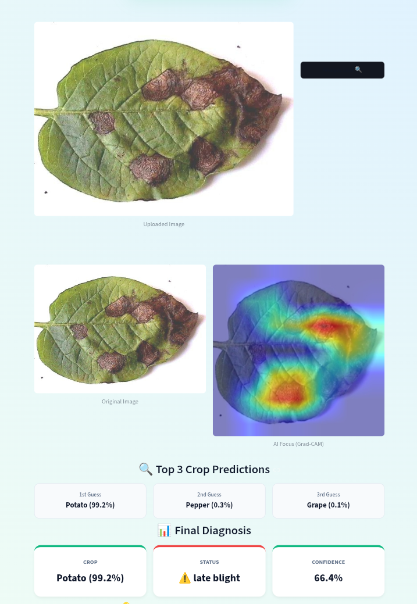

# 🌿 Verdant - Smart Crop Doctor

> **End-to-End Hierarchical Deep Learning Platform for Plant Disease Diagnosis with Explainable AI.**

## 🚀 Live Demo
Experience the application live: **[Verdant AI App](https://t9pirw.streamlit.app/)**

## 📖 Overview
**Verdant** is an advanced AI platform that diagnoses plant diseases from leaf images. Unlike traditional single-model approaches, Verdant uses a **Hierarchical Architecture** to maximize accuracy and scalability:
Change logic:
1. **M1 (Crop Detector):** Identifies the plant species from 14 supported crops.
2. **M2 (Disease Experts):** Routes the image to a specialized model for that specific crop to detect the exact disease.
3. **Explainable AI:** Uses **Grad-CAM* to show the user exactly *where* the disease is on the leaf, building trust in the AI's decision.

## ✨ Key Features
- **Hierarchical Inference:** Combines a general crop classifier with specialized disease experts.
- **Top-3 Predictions (Safety Net):** If the model is uncertain, it displays the top 3 most likely crops, preventing false diagnoses.
- **Actionable Treatment Plans:** Provides detailed, step-by-step recommendations (Immediate Actions, Organic, Chemical, and Preventive).
- **Explainable AI (XAI):** Visual heatmaps (Grad-CAM) highlight the infected areas on the leaf.
- **Modern UI/UX:** A clean, responsive, and user-friendly interface built with Streamlit.

## 🏗 System Architecture
Input Image -> M1 (Crop Detector) -> M2 (Disease Expert) -> Grad-CAM + Treatment Plan

## 📂 Project Structure
- app.py: Main Streamlit web application
- requirements.txt: Python dependencies
- treatments.json: Comprehensive treatment database
- models_14crops/: M1: General Crop Detector
- models_v2/: M2: Specialized Expert Models
- assets/: Images and screenshots
- docs/: Additional documentation

## ♂️ How to Run Locally
1. Clone the repository:
   git clone https://github.com/qamarsobhy7-source/plant-disease-detection.git
2. Install dependencies:
   pip install -r requirements.txt
3. Run the app:
   streamlit run app.py

## ⚠️ Limitations & Future Work
- **Domain Shift:** While the model achieves **97.4%** accuracy on lab-controlled datasets, real-world images may vary. We implemented a *Top-3 Prediction* safety net to mitigate this.
- Expand M1 dataset to include 30+ crops using real-world datasets.
- Build a REST API using FastAPI for mobile app integration.

## 📄 License
This project is licensed under the MIT License.
