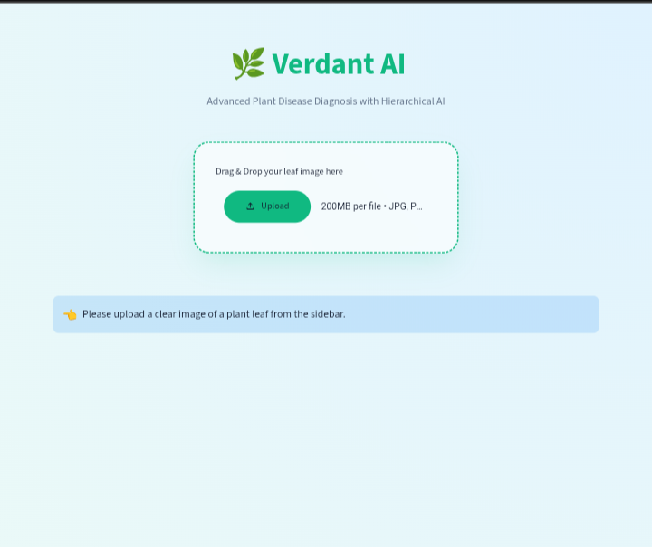
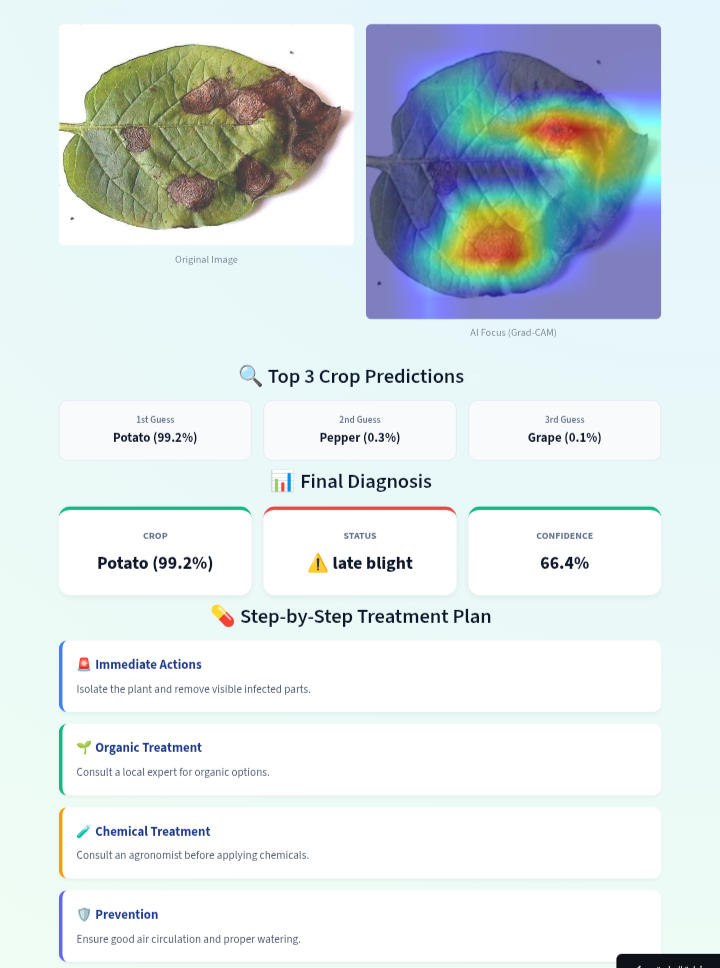

# 🌿 Verdant - Smart Crop Doctor

> **An End-to-End Hierarchical Deep Learning Platform for Plant Disease Diagnosis with Explainable AI (Grad-CAM).**


## 🚀 Live Demo
Experience the application live: **[Verdant AI App](https://plant-disease-detection-8fez5r9xxtyvoc3end7ywc.streamlit.app/)**

## 📸 Application Screenshots
<table>
  <tr>
    <td align='center'><b>1. Landing Page</b></td>
    <td align='center'><b>2. Diagnosis & Grad-CAM</b></td>
    <td align='center'><b>3. Treatment Plan</b></td>
  </tr>
  <tr>
    <td></td>
    <td></td>
    <td></td>
  </tr>
</table>

## 📖 Overview
**Verdant** is a robust AI platform designed to assist farmers and agricultural experts in diagnosing plant diseases accurately. Instead of relying on a single monolithic model, Verdant utilizes a **Hierarchical Architecture**:

1. **M1 (Crop Detector):** Identifies the plant species from 14 supported crops.
2. **M2 (Disease Experts):** Routes the image to a specialized model trained exclusively on the diseases of that specific crop.
3. **Explainable AI:** Utilizes **Grad-CAM** to visually highlight the infected areas on the leaf, building user trust.

## 🌱 Supported Crops
The system is trained on the PlantVillage dataset, supporting 14 primary crops and over 38 disease/healthy classes (including Tomato, Potato, Apple, Grape, Corn, and more).

## ✨ Key Features
- **Hierarchical Inference:** Combines a general crop classifier with specialized disease experts.
- **Top-3 Predictions (Safety Net):** Displays the top 3 most likely crops if the AI is uncertain, preventing false diagnoses.
- **Actionable Treatment Plans:** Provides step-by-step recommendations (Immediate Actions, Organic, Chemical, and Preventive).
- **Grad-CAM Visualizations:** Heatmaps that highlight infected areas.
- **Modern UI/UX:** A clean, responsive, and user-friendly interface built with Streamlit.

## 🏗️ System Architecture
```text
[Input Image] 
      │
      ▼
[M1: Crop Detector (EfficientNet-B0)] ──> Identifies Crop
      │
      ▼
[M2: Crop-Specific Expert] ──> Identifies Disease
      │
      ▼
[Grad-CAM Generator] + [Treatment Plan Database]
      │
      ▼
[Final Diagnosis & Recommendations]
```

## 🛠️ Tech Stack
- **Deep Learning:** PyTorch, Torchvision, EfficientNet-B0
- **Explainability:** PyTorch Grad-CAM
- **Frontend:** Streamlit (Custom CSS)
- **Deployment:** Streamlit Community Cloud

## 📂 Project Structure
```text
├── app.py                  # Main Streamlit web application
├── requirements.txt        # Python dependencies
├── treatments.json         # Treatment database
├── models_14crops/         # M1: General Crop Detector
├── models_v2/              # M2: Specialized Expert Models
├── assets/                 # Images and screenshots
├── docs/                   # Additional documentation
└── src/                    # Source code for training
```

## ⚙️ How to Run Locally
1. **Clone the repository:**
   ```bash
   git clone https://github.com/qamarsobhy7-source/plant-disease-detection.git
   cd plant-disease-detection
   ```
2. **Install dependencies:**
   ```bash
   pip install -r requirements.txt
   ```
3. **Run the Streamlit app:**
   ```bash
   streamlit run app.py
   ```

## 📄 License
This project is licensed under the MIT License - see the [LICENSE](LICENSE) file for details.